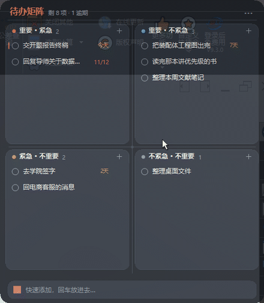
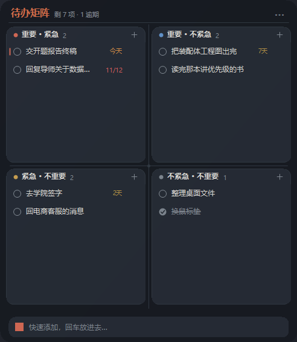
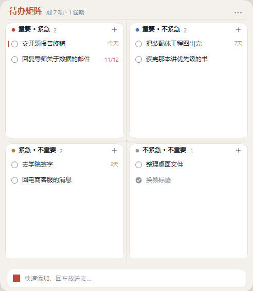
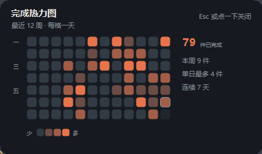

# DesktopTodo · Eisenhower Matrix

> A tiny todo widget that lives on your Windows desktop as a four-quadrant Eisenhower matrix. **One 40 KB exe.** No installer, no account, no cloud.

<p>
  
  
  
  
  
</p>

[简体中文](README.md) | **English**







---

## What it is

The Eisenhower matrix as a always-on-top desktop panel:

|  |  |
|---|---|
| **Important · Urgent** | Do now |
| **Important · Not urgent** | Schedule |
| **Urgent · Not important** | Do quickly / delegate |
| **Not urgent · Not important** | Someday |

Park it in a corner of the screen. One glance tells you what to do next — without opening another app or another tab.

## Why not just use an existing todo app

Most todo apps are open-it-and-close-it tools. Every extra step means one glance fewer. This project only solves one thing: **stay visible, take almost no space**.

|  | This | Typical Electron todo app |
|---|---|---|
| Size | 40 KB single exe | 100–200 MB installer |
| Install | copy & run | setup wizard |
| Account | none | usually required |
| Data | one local text file | cloud, needs network |
| Always on | borderless floating window, top-most, survives `Win+D` | normal window / tray |
| Startup | instant | 1–3 s |
| Runtime | .NET Framework 4.x (built into Win10/11) | bundles a browser |

## Features

- **Global hotkey** — `Ctrl+Alt+T` summons or tucks it away from anywhere
- **Drag between quadrants** — drag a task over another cell to re-prioritise it
- **Due reminders** — one tray balloon per day: "N due today · N overdue"
- **Completion heatmap** — last 12 weeks, one square per day
- **Four-quadrant matrix** — independent list, counter and `+` per quadrant
- **Due dates** — colour-coded inline (red = overdue, orange = today/tomorrow, amber = within 7 days, grey = later)
- **Pin** — keep one task at the top of its quadrant
- **Auto sorting** — pinned → active → by due date
- **Complete** — click the circle; done items sink and can be hidden
- **Quick add** — bottom input bar, click the colour chip to change the target quadrant
- **Context menu** — edit / move to another quadrant / pin / complete / delete
- **Floating behaviour** — borderless, rounded, resizable, remembers position, ignores `Win+D`, minimizes to tray
- **Opacity** — six levels (55–100%) so the desktop shows through
- **7 colour themes** × dark/light, with fixed semantic quadrant colours
- **Local storage** — `%APPDATA%\DesktopTodo\items.dat`, plain text
- **Start with Windows** — a single `HKCU\...\Run` entry, removable any time

## Build it yourself

Only the C# compiler shipped with Windows is needed — **no Visual Studio, no .NET SDK**:

```powershell
git clone https://github.com/<you>/desktop-todo.git
cd desktop-todo
powershell -ExecutionPolicy Bypass -File .\build.ps1
# output: dist\DesktopTodo.exe
```

Under the hood it is one command:

```
csc /target:winexe /optimize+ /win32icon:src\app.ico ^
    /r:System.dll /r:System.Core.dll /r:System.Drawing.dll /r:System.Windows.Forms.dll ^
    /out:dist\DesktopTodo.exe src\TodoFloat.cs
```

## How it works

The whole app is **one ~1200-line C# file** with zero third-party dependencies. Everything is hand-painted with `System.Drawing`:

- borderless window, rounded corners via `Region`
- four quadrants are four owner-drawn `Panel`s, each hosting an `OwnerDrawFixed` `ListBox`
- dragging via `WM_NCHITTEST` → `HTCAPTION`, resizing via `HTBOTTOMRIGHT`
- `WM_SYSCOMMAND / SC_MINIMIZE` is swallowed so "Show desktop" cannot hide it
- storage is `done|quad|due|pin|base64(text)`, one line per task, with migration from older formats

Single file is a deliberate choice: change a colour or a behaviour, re-run `build.ps1`, done.

## Data format

`%APPDATA%\DesktopTodo\items.dat`, UTF-8, one task per line:

```
0|0|2026-11-14|1|638300000000000000|5Lqk5byA6aKY5oql5ZGK57uI56i/
 ↑  ↑     ↑      ↑          ↑                   ↑
 |  |     |      |          |                   └ base64(text)
 |  |     |      |          └ completed-at (ticks, empty when not done)
 |  |     |      └ pinned
 |  |     └ due date (may be empty)
 |  └ quadrant 0-3
 └ done
```

## Roadmap

- [x] List + local storage
- [x] Native floating window (top-most / tray / autostart)
- [x] Matrix, due dates, pin, themes, opacity
- [x] Global hotkey (`Ctrl+Alt+T`)
- [x] Drag & drop between quadrants
- [x] Due reminders (tray balloon)
- [x] Daily completion heatmap
- [ ] Export to Markdown / CSV
- [ ] Portable mode (data next to the exe)
- [ ] Localized UI strings

## License

[MIT](LICENSE) © 2026 YG
