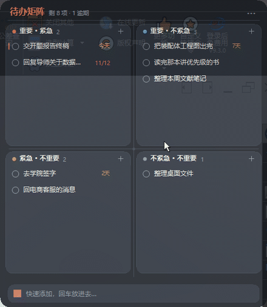
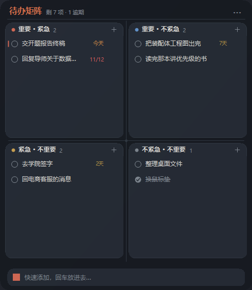
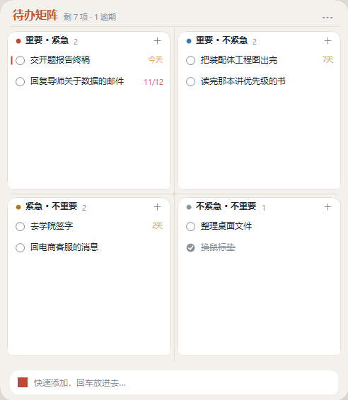
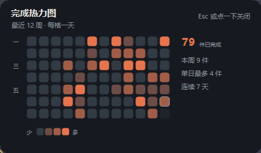

# 待办矩阵 · DesktopTodo

> 一个常驻桌面的**四象限待办悬浮窗**。单个 `exe`，40 KB，不安装、不登录、不联网。

<p>
  
  
  
  
  
</p>

**简体中文** | [English](README.en.md)







---

## 这是什么

把艾森豪威尔矩阵（时间管理四象限）做成一块贴在桌面上的小板子：

|  |  |
|---|---|
| **重要 · 紧急** | 马上做 |
| **重要 · 不紧急** | 排进日程 |
| **紧急 · 不重要** | 尽快打发 |
| **不紧急 · 不重要** | 有空再说 |

拖着窗口放在屏幕角落，斜眼一扫就知道现在该干什么。不需要切换标签页，不需要先打开某个应用。

## 为什么不用现成的待办软件

大多数待办 App 是「打开它 → 知道自己该干嘛 → 关掉」的形态，多一步就少一次。这个项目从头只解决一件事：**让它一直在你眼前，而且几乎不占地方**。

|  | 本项目 | 典型 Electron 待办 App |
|---|---|---|
| 体积 | 40 KB 单文件 | 100–200 MB 安装包 |
| 安装 | 复制到任意目录双击 | 安装向导 |
| 账号 | 无 | 通常要注册 |
| 数据 | 本机一个文本文件 | 云端，需联网 |
| 常驻 | 无边框悬浮窗，可置顶，`Win+D` 不会被收起 | 普通窗口 / 托盘 |
| 启动 | 立刻 | 1–3 秒 |
| 依赖 | .NET Framework 4.x（Win10/11 自带） | 打包一整个浏览器内核 |

## 功能

- **全局快捷键**：`Ctrl+Alt+T` 随时呼出 / 收起，不用去托盘里找
- **跨象限拖拽**：把任务从一格拖到另一格，即改优先级，落点会高亮
- **到期提醒**：每天第一次启动在托盘弹一次「今天 N 件 · 逾期 N 件」
- **完成热力图**：最近 12 周每天完成多少，深色格子就是你的节奏
- **四象限矩阵**：每格独立列表、计数、`+` 新建
- **截止日期**：行尾显示，颜色即状态（红=已过期、橙=今天/明天、黄褐=7 天内、灰=更远）
- **置顶**：把某条钉在自己那格的第一行，带色条标记
- **拖动排序**：按「置顶 → 未完成 → 截止日期」自动排
- **完成**：点圆圈划掉并沉底，可一键隐藏所有已完成
- **快速添加**：底部输入条 + 一颗色块切换目标象限，回车即存
- **右键菜单**：编辑 / 移动到其他象限 / 置顶 / 标记完成 / 删除
- **悬浮窗行为**：无边框圆角、置顶、任意拉伸、位置记忆、`Win+D` 免疫、关闭即缩到托盘
- **不透明度**：55%–100% 六档，透出一点桌面但不影响阅读
- **7 套配色** × 深色/浅色 × 四象限语义色固定（换色也不会认错格）
- **本地存储**：`%APPDATA%\DesktopTodo\items.dat`，纯文本，可备份可 diff
- **开机自启**：`HKCU\...\Run`，随时可关

## 操作

| 操作 | 方式 |
|---|---|
| 完成 / 取消完成 | 点左侧圆圈，或选中后按 `空格` |
| 删除 | 鼠标划过行尾的 `×`，或选中后按 `Delete` |
| 编辑内容 / 改日期 / 换象限 | 双击，或右键 → 编辑 |
| 新建（带日期） | 点某格右上角的 `+` |
| 新建（快速） | 底部输入条，回车 |
| 切换快速添加的目标格 | 点输入条左侧的小色块 |
| 换象限 | 直接把任务拖到别的格子里 |
| 呼出 / 收起窗口 | `Ctrl+Alt+T`（全局，任何时候都有效） |
| 看完成热力图 | `⋯` → 完成热力图 |
| 移动窗口 | 拖顶部标题区 |
| 调整大小 | 拖右下角 |
| 菜单（透明度/配色/自启/退出） | 右上角 `⋯` 或托盘图标右键 |

## 下载与安装

1. 到 [Releases](../../releases) 下载 `DesktopTodo.exe`
2. 放到任意目录（例如 `%LOCALAPPDATA%\Programs\DesktopTodo\`），双击运行
3. 想开机自启：`⋯` → 勾选「开机自启」

没有安装程序，没有写注册表以外的任何东西，卸载 = 删掉 exe 和 `%APPDATA%\DesktopTodo` 目录。

## 自己编译

只能用 Windows 自带的 C# 编译器，**不需要装 Visual Studio，也不需要 .NET SDK**：

```powershell
git clone https://github.com/<you>/desktop-todo.git
cd desktop-todo
powershell -ExecutionPolicy Bypass -File .\build.ps1
# 产物：dist\DesktopTodo.exe
```

本质上就是一行命令：

```
csc /target:winexe /optimize+ /win32icon:src\app.ico ^
    /r:System.dll /r:System.Core.dll /r:System.Drawing.dll /r:System.Windows.Forms.dll ^
    /out:dist\DesktopTodo.exe src\TodoFloat.cs
```

## 实现说明

整个程序是**一个 1200 行的 C# 文件**，没有第三方库，没有 XAML，界面全部靠 `System.Drawing` 手绘：

- 无边框窗口 + `Region` 圆角裁剪
- 四象限是四个自绘 `Panel`，每个内嵌一个 `OwnerDrawFixed` 的 `ListBox`
- 拖动窗口靠 `WM_NCHITTEST` 返回 `HTCAPTION`，拉伸靠 `HTBOTTOMRIGHT`
- 拦截 `WM_SYSCOMMAND / SC_MINIMIZE`，所以 `Win+D` 收不起它
- 数据层就是 `done|quad|due|pin|base64(text)` 一行一条，兼容老格式自动迁移

代码刻意保持单文件，方便你直接改一个颜色、加一行逻辑，然后 `build.ps1` 重编译。

## 数据格式

`%APPDATA%\DesktopTodo\items.dat`，UTF-8，一行一条：

```
0|0|2026-11-14|1|638300000000000000|5Lqk5byA6aKY5oql5ZGK57uI56i/
 ↑  ↑     ↑      ↑          ↑                   ↑
 |  |     |      |          |                   └ base64(任务文字)
 |  |     |      |          └ 完成时间（Ticks，未完成留空）
 |  |     |      └ 是否置顶
 |  |     └ 截止日期（可为空）
 |  └ 象限 0-3
 └ 是否完成
```

v0.3 及更早的 5 段 / 3 段格式仍能读入，会自动补齐字段。

想批量导入？写个脚本生成这个文件，重启程序即可。

## 路线图

- [x] 列表版 + 本地存储
- [x] 原生悬浮窗（置顶 / 托盘 / 自启）
- [x] 四象限矩阵 / 截止日期 / 置顶 / 配色 / 透明度
- [x] 全局快捷键（`Ctrl+Alt+T` 呼出 / 收起）
- [x] 象限之间拖拽移动
- [x] 到期提醒（托盘气泡）
- [x] 每日完成热力图
- [ ] 导出 Markdown / CSV
- [ ] 便携模式（数据放 exe 同目录）
- [ ] 英文界面

欢迎在 [Issues](../../issues) 里投票或提需求。

## 许可

[MIT](LICENSE) © 2026 YG
